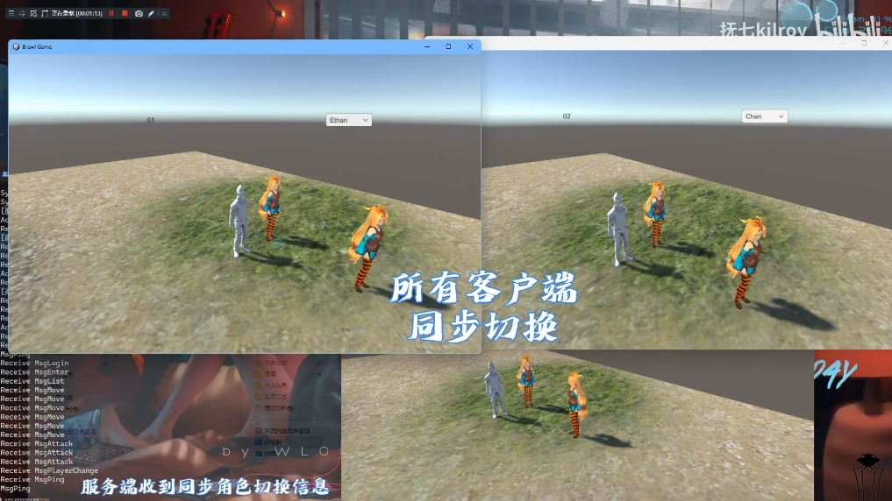
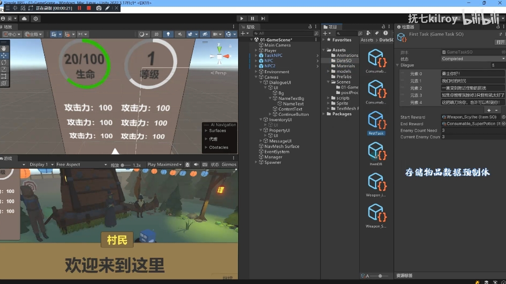

# 简历

<a href="/HEXO/img/Unity.pdf" >Unity简历 →</a>
<a href="/HEXO/img/C++.pdf" >C++简历 →</a>

欢迎来到我的作品集！以下是我在不同领域的项目成果，点击分类标签切换查看。



<!-- tab 💻 编程作品 -->

### ⚡ Reactor模式C++ HTTP服务器

独立设计 | 2026.1 - 2026.3

一款高并发Web服务器，采用多线程Reactor + Epoll事件驱动架构，解决传统阻塞式服务器在高并发场景下的性能瓶颈。
基于主从Reactor模式，主线程负责监听新连接，工作线程通过Epoll实现IO多路复用；
使用有限状态机高效解析HTTP报文，支持分块接收与超大请求处理；
采用RAII思想封装Socket、Channel、Connection等资源；
实现O(1)时间复杂度的定时器轮盘进行非活跃连接检测；
自研环形缓冲区（Buffer），支持动态扩容与零拷贝数据移动。

**技术栈：** `C++11` `Linux` `Epoll` `Reactor` `线程池` `状态机` `RAII` `HTTP/1.1`

  <a href="/HEXO/portfolio/programming/reactor-http-server/" style="display: inline-block; padding: 8px 24px; background: #42b983; color: #fff; border-radius: 20px; text-decoration: none; font-size: 14px; font-weight: 500; transition: background 0.3s;">查看详情 →</a>

---

### 🚄 智能交通票务系统

全栈开发者 | 2025.10 - 2025.12

基于SpringBoot框架融合大模型技术的智能交通票务系统，集成DeepSeek、阿里万相等多模态生成式AI能力。
通过LangChain进行多轮对话交互和RAG检索增强，支持自然语言完成车票查询、预订、退改等全流程操作。
针对高并发场景使用乐观锁机制防止车票超售，通过"工具调用"机制将用户意图精准映射至后端票务接口，并搭建了完整的文生图流水线。

**技术栈：** `SpringBoot` `大语言模型` `LangChain` `RAG` `多模态生成式AI`

  <a href="/HEXO/portfolio/programming/Ai-ticket/" style="display: inline-block; padding: 8px 24px; background: #42b983; color: #fff; border-radius: 20px; text-decoration: none; font-size: 14px; font-weight: 500; transition: background 0.3s;">查看详情 →</a>

---

<!--
### 🌐 C++高并发HTTP服务器

开源项目作者 | 2025.8 - 2025.9

基于现代C++17构建的多线程HTTP服务器，采用RAII资源管理、生产者-消费者模式和智能指针等特性，实现从Socket通信到HTTP协议解析的全栈式框架。自主构建基于C++17标准的线程池系统，通过模板元编程实现万能引用和完美转发，支持任意可调用对象任务提交；全面采用RAII原则管理Socket和文件描述符等系统资源，杜绝资源泄漏；自主实现HTTP/1.1协议解析器，支持静态文件服务。

**技术栈：** `C++17` `多线程` `RAII` `HTTP/1.1` `Socket` `select()` `模板元编程`

  <a href="/HEXO/portfolio/programming/httpserver/" style="display: inline-block; padding: 8px 24px; background: #42b983; color: #fff; border-radius: 20px; text-decoration: none; font-size: 14px; font-weight: 500; transition: background 0.3s;">查看详情 →</a>

---
-->

### 🧵 非遗刺绣科普微信小程序

全栈开发者 | 2024.4 - 2024.6

一款基于微信小程序和云开发构建的非遗文化科普平台，集成文化传播、视频宣传、趣味游戏、商城购物等全功能模块。
深度集成微信云开发作为BaaS，实现前后端无缝对接；
设计并实现视频瀑布流与弹幕系统，增强用户互动；
开发拼图游戏与猜数字游戏，在游戏胜利时触发刺绣文化知识弹窗，实现"寓教于乐"；
基于云数据库实现商品列表分页加载与懒加载；建立深红主色+淡黄辅色的传统视觉体系。

**技术栈：** `微信小程序` `JavaScript` `微信云开发` `云数据库` `WeUI`

  <a href="/HEXO/portfolio/programming/embroidery/" style="display: inline-block; padding: 8px 24px; background: #42b983; color: #fff; border-radius: 20px; text-decoration: none; font-size: 14px; font-weight: 500; transition: background 0.3s;">查看详情 →</a>

<!-- endtab -->

<!-- tab 🎮 游戏作品 -->

### ⚔️ BrawlGame - 多人联机网络框架

游戏网络模块开发 | 2025.9 - 2025.10

基于C#和认Unity的高性能TCP网络通信框架，从底层协议编解码、异步非阻塞IO到上层事件驱动分发，完整支撑用户证、角色管理、实时位置/攻击同步等多人游戏业务逻辑。
设计了`[包长度(2字节)] + [协议名(变长)] + [JSON体(变长)]`的自定义协议，彻底解决TCP粘包问题；
基于async/await和SocketAsync API实现异步非阻塞网络核心；采用状态同步思想实现多端平滑同步；内置心跳保活机制处理网络异常。

**技术栈：** `Unity` `C#` `TCP/IP` `异步IO` `自定义协议` `观察者模式`

  <a href="/HEXO/portfolio/game/BrawlGame/" style="display: inline-block; padding: 8px 24px; background: #42b983; color: #fff; border-radius: 20px; text-decoration: none; font-size: 14px; font-weight: 500; transition: background 0.3s;">查看详情 →</a>

---

### 🎮 SimpleRPG - Unity RPG核心系统

Unity游戏开发 | 2025.8 - 2025.9

基于Unity引擎的RPG游戏核心系统，采用数据驱动与事件驱动的混合架构，完整覆盖玩家移动、物品拾取、武器装备、任务系统、敌人AI、背包UI等RPG核心玩法链路。
基于NavMeshAgent实现鼠标点击移动，通过射线检测区分地面与可交互对象；
构建可扩展的交互与任务系统，基于GameTaskSO任务状态机管理任务进度；
设计Weapon基类及近战/远程派生类；
敌人具备战斗/移动/休息三种状态，支持随机寻路与计时器驱动切换。

**技术栈：** `Unity` `C#` `NavMeshAgent` `ScriptableObject` `事件中心` `单例模式`

  <a href="/HEXO/portfolio/game/SimpleRPG/" style="display: inline-block; padding: 8px 24px; background: #42b983; color: #fff; border-radius: 20px; text-decoration: none; font-size: 14px; font-weight: 500; transition: background 0.3s;">查看详情 →</a>

<!-- endtab -->

<!-- tab 🎨 美术作品 -->

<!-- endtab -->



---

### 📌 关于项目

以上项目均为个人独立或合作完成。点击每个卡片底部的「查看详情」可阅读完整项目介绍、技术实现细节和开发心得。

**版权声明：** 所有项目代码及内容均为原创，未经授权请勿转载或商用。

## 个人经历时间线

### 2025.03 - 至今 | 全球绿洲气候基金（GOCF）| 信息技术部副部长 | 线上

负责GOCF联合国六种官方语言（中文、英文、法文、西班牙文、俄文、阿拉伯文）网站的日常运营维护与内容编辑管理，确保各语言版本信息发布的准确性与时效性。

面对多语言内容编辑与校对挑战，通过组合使用多种专业翻译工具（Trados、Google Translate、DeepL）进行交叉比对，并辅以基础词法语法检查，有效降低语义误差。建立多轮校对机制，对重要公告及政策文件实行"翻译-初校-复校"三级审核流程，显著提升多语言内容一致性。协助部门制定非熟悉语种内容处理标准作业程序，推动形成系统化的多语言协作校对流程。

---

### 2025.03 - 2025.06 | 广东湾区智能终端工业设计研究院有限公司-华勤技术股份有限公司 | 智能穿戴设备测试实习生 | 东莞

**核心项目：vivo健康运动手环全功能测试**

在测试组长指导下，独立执行运动/健康/GPS/睡眠/电竞模式等核心模块的功能验证，覆盖20+运动场景识别精准度、健康数据监测可靠性及第三方应用兼容性测试。

主导关键性能基准测试：应用冷热启动响应速度（平均优化15%）、UI动效帧率稳定性（≥57fps达标率98%）、AOD息屏显示迭代版本功耗对比。

实施自动化测试：运用Monkey进行24h+压力测试，拦截系统级崩溃3次；执行DFT测试脚本，缺陷检出率提升30%。

**跨部门协作经验**

支援联想平板事业部，完成显示触控/多任务切换/APP权限授予等基础功能测试，快速适应新硬件平台。外派vivo深圳总部参与联调测试，主导用户场景问题复现，推动核心BUG 48小时内闭环。

---

### 2025.07 - 2025.08 | 广州粤嵌通信科技股份有限公司 | JAVA开发实习生 | 广州

**核心职责：** 参与企业级智能客服系统与铁路智能售票平台开发，负责RAG问答模块构建、前端无障碍优化及前后端联调。

**主要成果：**

- **智能客服系统：** 基于Spring Boot + LangChain4j + deepseekv1 + 千问百炼文生图大模型，实现语义检索与多轮对话记忆功能，支持流式响应输出；通过MyBatis-Plus设计MySQL持久化存储，按用户ID管理对话记录。
- **前端无障碍优化：** 为铁路售票平台新增语音播报（Web Speech API）、敬老模式（字体放大）和高对比度模式，提升视障及老年用户体验；优化车次多条件筛选与排序功能。
- **工程化实践：** 参与接口联调，解决流式响应中文乱码、乐观锁更新失效等问题；使用Git + Conventional Commits规范协同开发，通过日志与断点定位缺陷。

**技术栈：** Java、Spring Boot、Maven、MyBatis-Plus、LangChain4j、MySQL、Web Speech API、Git

---

### 2026.03 - 2026.05 | 中科创达软件股份有限公司 | C++开发工程师

**项目背景：** 公司希望开发一个音视频通话软件，促进人才培养，推动公司发展，同时保证公司商业机密不会泄露，支持功能定制，也可投放到市场中盈利。

**项目目标：** 开发一款音视频会议软件，具备实时音视频通话、视频直播、多人在线会议、屏幕共享、多人互动及聊天、培训课程制作等功能，帮助用户进行远程沟通与协作，打造易学、易用、好用的音视频会议软件。

**主要工作：** 负责回源模块的架构设计与功能实现。

1. 负责回源URL管理部分的架构设计以及代码实现逻辑设计。
2. 负责回源功能的设计与实现，基于RTMP协议实现回源过程中请求中心服务器的实时数据流。
3. 负责RTMP协议的会话管理实现，主要负责协议和消息类型的处理以及消息的解析与处理。
4. 负责日常代码的开发与使用文档的撰写，回源功能自验证，协助测试团队进行集成测试。

---

### 2026.07 - 2026.08 | 青岛大蜥蜴娱乐游戏有限公司 | 游戏研发程序员

**核心职责：** 负责多款小游戏（Unity）的SDK接入、广告组件升级、打包发布及线上问题排查。

**主要工作：**

- 独立完成多个项目的SDK接入与广告埋点配置，包括黑包/白包/宝箱等广告类型，覆盖开始、暂停、结算等关键节点。
- 负责广告组件新旧替换与升级，清理旧AD及工具包依赖，处理引用冲突、DLL加载失败等兼容性问题。
- 执行打包、批处理与手机端测试，针对OPPO/Vivo/小米等平台差异调整参数与屏蔽时间，完成审核提交与运营通知。
- 排查并修复线上问题：广告不展示、插屏参数不共用、触摸方向反向、资源丢失、加载卡死等，涉及代码修复、资源还原与AI辅助调试。
- 维护隐私政策、包体大小限制、logo图标等平台合规要求，确保各渠道包正常上架。

**技术栈：** Unity、C#、SDK接入、广告组件、Git、多平台打包（RPK）

---

### 2026.08 - 2026.09 | 长沙奇葩斗斗网络科技有限公司 | 游戏服务器开发

**核心职责：** 负责游戏服务端环境搭建与基础运维。

**主要工作：**

- 负责虚拟机连接与服务器环境配置，包括MariaDB、Redis等基础服务的部署与密码管理。
- 处理Debian系统下root SSH登录限制等运维问题，通过修改sshd_config并重启服务解决。
- 参与游戏服务器日常开发与维护，注重Linux基础与服务器端稳定性。

**技术栈：** Linux、Debian、MariaDB、Redis、SSH、服务器运维
